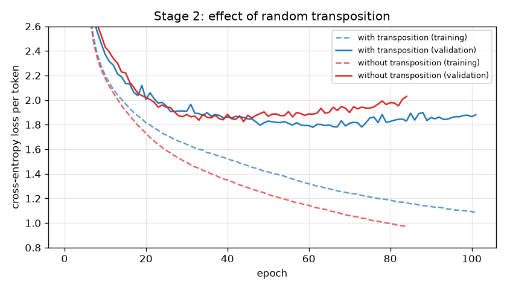
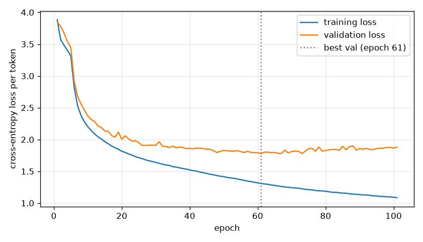
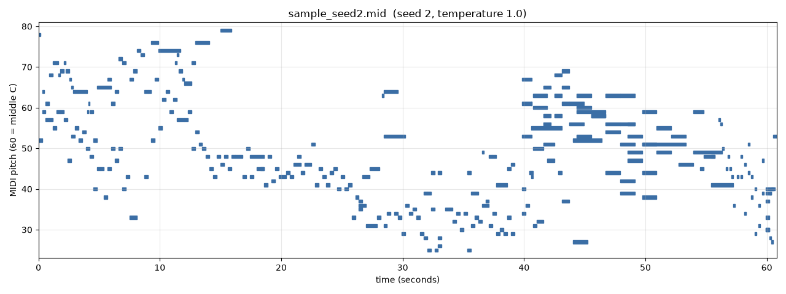

# What limits an LSTM piano composer? A stage-by-stage study

Ojasvi Tewari · NeuralSymphonizer · November 2026

*This write-up grows one stage at a time. Each stage is one or two commits on the
`complete-generation` branch, and the trained model, samples and recordings of every
stage are kept under `results/` so the progression can be heard, not just read.*

## 1. Introduction

NeuralSymphonizer began as a reproduction of a well-known tutorial, Sigurður Skúli's
*How to Generate Music using a LSTM Neural Network in Keras* (2017) [Skuli2017]: parse
classical piano MIDI files into a sequence of notes and chords, train a stacked LSTM to
predict the next one, then sample from it. The first working version (stage 1 below)
does generate notes, but listening to it and measuring it shows several separate
limits. This study removes them one at a time and records, for each stage:

- **the wall**: what limited the previous stage, with the evidence;
- **the change**: what was done about it, and why that change;
- **the result**: training numbers, structural statistics, audio, and from stage 3 on
  an objective comparison with real music.

The model architecture is deliberately kept the same for as long as possible (three
LSTM layers of 512 units), so that each improvement can be attributed to data,
representation, sampling or training rather than to a bigger network.

## 2. Data

**piano-midi.de.** 95 MIDI files of piano music by Chopin, Beethoven and Mozart from
Bernd Krueger's collection [Krueger], under CC BY-SA (Germany). The repository
originally had 100 files; 5 were byte-identical duplicates and were removed. The files
are step-sequenced rather than recorded performances, and they carry detailed tempo
maps (median 848 tempo changes per file). In total they contain 261,037 notes.

**Split.** 10% of the pieces, 10 of the 95, are held out for validation with a fixed
seed (42). They are listed in each stage's `model/config.json`. Whole pieces are held
out, so no validation window overlaps a training window. The same 10 pieces are used
in every stage.

## 3. Common setup

- **Model:** an embedding, then three stacked LSTM layers of 512 units, each followed
  by dropout 0.2, then a 256-unit dense layer and a softmax over the vocabulary. The
  optimizer is RMSprop with cross-entropy loss. It has about 5.5 to 5.8 million
  parameters, depending on the vocabulary.
- **Software:** Keras 3.15.1 on the PyTorch 2.11 backend (CUDA 12.8), on one NVIDIA
  RTX 5070 under Windows 11.
- **Checkpointing:** the weights with the lowest validation loss are kept.
- **Audio:** `render_audio.py` plays every sample through a General MIDI piano
  SoundFont (TimGM6mb, bundled with `pretty_midi`) and writes an MP3. The MP3s are
  checked automatically without listening: the decoded length matches the MIDI,
  nothing is silent while a note is held, and at each single-note onset the frequency
  whose energy rises most is that note's pitch or one of its first four harmonics.

## 4. Experiments

### 4.1 Stage 1: the tutorial baseline

`results/stage1-baseline/` · code at commit `fc3f7a8`

**Representation.** `music21` parses each file. A single note becomes its pitch name
(`E5`), and a chord becomes the pitch classes of its normal order (`4.7.11`). Timing,
durations, rests and dynamics are dropped. This gives 107,061 tokens and a vocabulary
of 780.

**Training.** Many-to-one: 50 tokens in, the next token out. 100 epochs, batch size 64,
43.8 minutes in total.

**Generation.** Every generated token is written as an eighth note at 120 bpm, with
chords placed in the octave above middle C.

| | epoch | training loss | validation loss | validation accuracy |
|---|---|---|---|---|
| best by validation loss | 8 | 3.848 | 4.192 | 12.7% |
| last | 100 | 1.179 | 5.890 | 7.4% |

For scale, a model that knows only how often each token occurs scores 5.27 on the
validation set, and uniform guessing scores 6.66.

Listen: [seed 1](results/stage1-baseline/samples/sample_seed1.mp3) ·
[seed 2](results/stage1-baseline/samples/sample_seed2.mp3) ·
[seed 3](results/stage1-baseline/samples/sample_seed3.mp3)

### 4.2 Stage 2: timing, octaves and transposition

`results/stage2-rhythm-transpose/` · code at commit `e10cc4d`

**The wall.** Stage 1 had four separate problems, all measurable without listening:

1. **No rhythm.** Every output note lasts an eighth note, because the tokens carry no
   time. In the real data, measured on a grid of 1/24 of a beat, it takes 12
   different gaps between onsets to cover 99% of onsets, and 24 different note
   lengths to cover 99% of notes. The most common length is a sixteenth note, with
   94,148 notes.
2. **Chords lose their octave.** A chord token keeps only pitch classes, and 65.1% of
   the 66,714 chords in the data span more than an octave. All of them were squeezed
   into one octave on output; that is the dense band around middle C in the stage-1
   piano rolls.
3. **A sixth of the data was never read.** The parser kept
   `partitionByInstrument(...).parts[0]` from the tutorial. In 16 of the 95 files that
   first part is an empty instrument named after the track title, so those pieces
   produced no tokens at all. Stage 1 really trained on 71 pieces and validated on 8.
   The missing pieces include every movement of the Appassionata, Pathétique and
   Waldstein sonatas.
4. **Overfitting after 8 epochs.** About 93,500 training windows were not enough for
   5.8 million parameters. Validation loss bottomed out at epoch 8 and then rose for
   92 epochs.

**The change.**

- **Event tokens** (`music_tokens.py`). Each note becomes `P<pitch>` (the exact MIDI
  pitch, so chords keep their voicing) followed by `D<length>`. `S<n>` tokens advance
  time on a grid of 1/24 of a beat, and notes that start together share a time
  position. Lengths and shifts are snapped to 16 values from a 64th-note triplet to a
  whole note, with longer gaps written as several shifts. The vocabulary is 120 tokens.
  This is the same family as the event representations of Performance RNN [Oore2018]
  and REMI [Huang2020]; it has no velocity, tempo or bar tokens. Encoding a file and
  decoding it again reproduces its notes exactly.
- **Read every note** with `pretty_midi`. This fixes problem 3: all 95 pieces now
  contribute, 668,058 tokens in total.
- **Predict at every position.** The same tokens are now about six times longer than
  stage 1's, so the model reads 256-token windows (about 56 onsets, roughly what
  stage 1's 50 tokens covered) and is trained to predict the next token at every
  position of the window, not only the last.
- **Transposition into all 12 keys.** Each time a training window is used, it is
  shifted by a random −6 to +5 semitones, kept within the piano's range. Harmony and
  rhythm are unchanged by transposition, so this multiplies the effective data without
  inventing new music. It targets problem 4.
- **Unchanged:** the model (3 × 512), the optimizer, dropout, the split and the
  sampling (temperature 1.0). Training stops after 40 epochs without improvement.

**Result.** 101 epochs in 5.8 minutes, about 3.5 seconds per epoch.

| | epoch | training loss | validation loss | validation accuracy |
|---|---|---|---|---|
| best by validation loss | 61 | 1.310 | 1.779 | 51.8% |
| last (early stop) | 101 | 1.085 | 1.882 | 50.6% |

These losses are per event token, not per note or chord, so they cannot be compared
with stage 1's numbers. Section 4.3 introduces a comparison that works across stages.

**Ablation: how much does transposition do?** The same run without transposition
(`results/stage2-rhythm-transpose/ablation-no-transpose/`) reached its best
validation loss sooner and higher, then overfit faster:

| | best epoch | best validation loss | validation loss at epoch 84 | training loss at epoch 84 |
|---|---|---|---|---|
| with transposition | 61 | 1.779 | 1.830 | 1.164 |
| without | 44 | 1.825 | 2.029 | 0.969 |

Transposition makes the training task harder: training loss stays higher, so the model
memorises less, and validation loss improves by 0.046 at the best epoch and by 0.20 at
epoch 84. It delays overfitting but does not remove it. Validation loss still
flattens by about epoch 40 while training loss keeps falling, so the corpus is still
too small for the model. That points to data (stage 4).

Three samples of 300 notes each, written at 100 bpm, with the same seeds and prompts
drawn from the held-out pieces as before:

| sample | prompt from | length | onsets | chord onsets | distinct pitches | range (MIDI) | distinct note lengths | ill-formed tokens |
|---|---|---|---|---|---|---|---|---|
| [seed 1](results/stage2-rhythm-transpose/samples/sample_seed1.mp3) | `chpn_op35_4` | 36.6 s | 153 | 75 | 54 | 25–106 | 15 | 4 of 752 |
| [seed 2](results/stage2-rhythm-transpose/samples/sample_seed2.mp3) | `mz_311_1` | 60.8 s | 187 | 80 | 52 | 25–79 | 9 | 9 of 790 |
| [seed 3](results/stage2-rhythm-transpose/samples/sample_seed3.mp3) | `chpn_op53` | 17.3 s | 133 | 86 | 53 | 24–106 | 11 | 4 of 730 |

What changed is visible in the piano rolls: notes of many lengths, rests, chords
spread over several octaves, and a register that moves through the piece. The model
also learned the token grammar almost perfectly: about 1% of generated tokens are
ill-formed, for example a pitch without a length, and the decoder repairs them with a
default length. The audio check found the expected pitch rising at 206 of 231
single-note onsets (89%). The misses are mostly in the fastest sample (seed 3: 300
notes in 17 seconds), where onsets overlap within the analysis window. No 250 ms
window is silent while a note is held.

**What is still wrong.** The samples vary a lot in density: 300 notes took between
17 s and 61 s. They contain stray extreme notes, such as the isolated MIDI 106 in seed
1, which is typical of sampling the full distribution at temperature 1.0. There is
also still no way to say whether stage 2 is better than stage 1 in a number rather
than a picture. Stage 3 addresses both.
