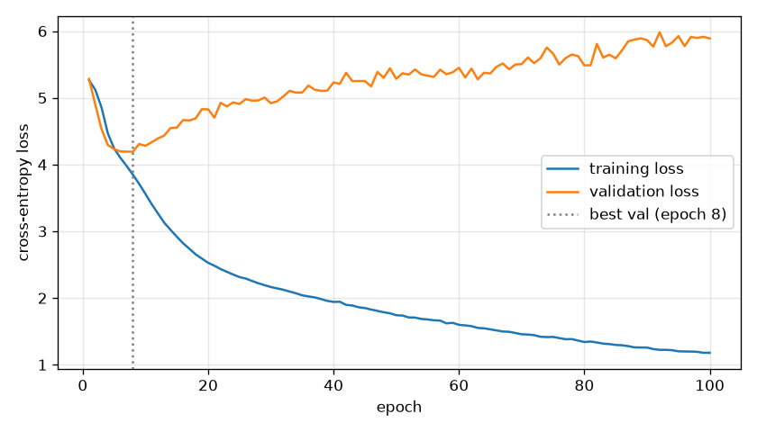
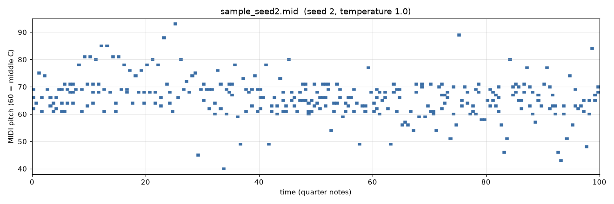
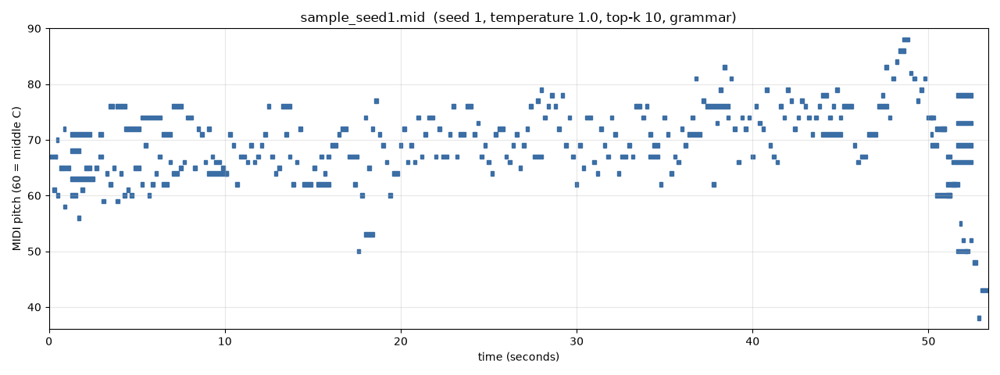
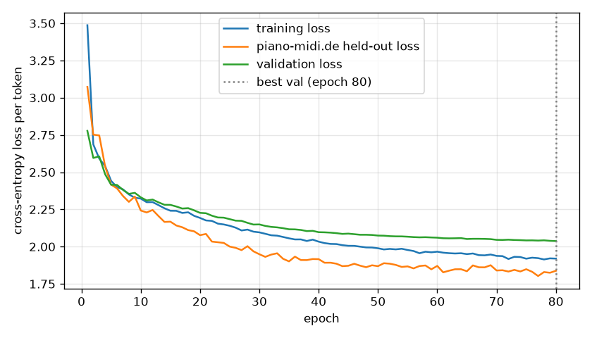
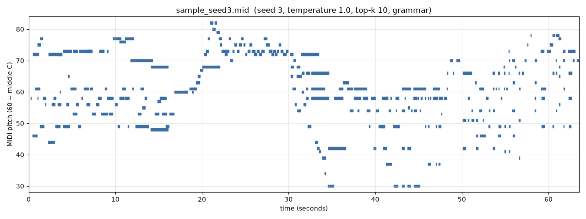

# What limits an LSTM piano composer? A stage-by-stage study

Ojasvi Tewari · NeuralSymphonizer · November 2026

*This write-up grows one stage at a time. Each stage is one or two commits on the
`complete-generation` branch, and the trained model, samples and recordings of every
stage are kept under `results/` so the progression can be heard, not just read.*

## 1. Introduction

NeuralSymphonizer began as a reproduction of a well-known tutorial, Sigurður Skúli's
*How to Generate Music using a LSTM Neural Network in Keras* (2017) [Skuli2017]: parse
classical piano MIDI files into a sequence of notes and chords, train a stacked LSTM to
predict the next one, then sample from it. The first working version (stage 1 below)
does generate notes, but listening to it and measuring it shows several separate
limits. This study removes them one at a time and records, for each stage:

- **the wall**: what limited the previous stage, with the evidence;
- **the change**: what was done about it, and why that change;
- **the result**: training numbers, structural statistics, audio, and from stage 3 on
  an objective comparison with real music.

The model architecture is deliberately kept the same for as long as possible (three
LSTM layers of 512 units), so that each improvement can be attributed to data,
representation, sampling or training rather than to a bigger network.

## 2. Data

**piano-midi.de.** 95 MIDI files of piano music by Chopin, Beethoven and Mozart from
Bernd Krueger's collection [Krueger], under CC BY-SA (Germany). The repository
originally had 100 files; 5 were byte-identical duplicates and were removed. The files
are step-sequenced rather than recorded performances, and they carry detailed tempo
maps (median 848 tempo changes per file). In total they contain 261,037 notes.

**Split.** 10% of the pieces, 10 of the 95, are held out for validation with a fixed
seed (42). They are listed in each stage's `model/config.json`. Whole pieces are held
out, so no validation window overlaps a training window. The same 10 pieces are used
in every stage.

## 3. Common setup

- **Model:** an embedding, then three stacked LSTM layers of 512 units, each followed
  by dropout 0.2, then a 256-unit dense layer and a softmax over the vocabulary. The
  optimizer is RMSprop with cross-entropy loss. It has about 5.5 to 5.8 million
  parameters, depending on the vocabulary.
- **Software:** Keras 3.15.1 on the PyTorch 2.11 backend (CUDA 12.8), on one NVIDIA
  RTX 5070 under Windows 11.
- **Checkpointing:** the weights with the lowest validation loss are kept.
- **Audio:** `render_audio.py` plays every sample through a General MIDI piano
  SoundFont (TimGM6mb, bundled with `pretty_midi`) and writes an MP3. The MP3s are
  checked automatically without listening: the decoded length matches the MIDI,
  nothing is silent while a note is held, and at each single-note onset the frequency
  whose energy rises most is that note's pitch or one of its first four harmonics.

## 4. Experiments

### 4.1 Stage 1: the tutorial baseline

`results/stage1-baseline/` · code at commit `fc3f7a8`

**Representation.** `music21` parses each file. A single note becomes its pitch name
(`E5`), and a chord becomes the pitch classes of its normal order (`4.7.11`). Timing,
durations, rests and dynamics are dropped. This gives 107,061 tokens and a vocabulary
of 780.

**Training.** Many-to-one: 50 tokens in, the next token out. 100 epochs, batch size 64,
43.8 minutes in total.

**Generation.** Every generated token is written as an eighth note at 120 bpm, with
chords placed in the octave above middle C.

| | epoch | training loss | validation loss | validation accuracy |
|---|---|---|---|---|
| best by validation loss | 8 | 3.848 | 4.192 | 12.7% |
| last | 100 | 1.179 | 5.890 | 7.4% |

For scale, a model that knows only how often each token occurs scores 5.27 on the
validation set, and uniform guessing scores 6.66.

Listen: [seed 1](results/stage1-baseline/samples/sample_seed1.mp3) ·
[seed 2](results/stage1-baseline/samples/sample_seed2.mp3) ·
[seed 3](results/stage1-baseline/samples/sample_seed3.mp3)

### 4.2 Stage 2: timing, octaves and transposition

`results/stage2-rhythm-transpose/` · code at commit `e10cc4d`

**The wall.** Stage 1 had four separate problems, all measurable without listening:

1. **No rhythm.** Every output note lasts an eighth note, because the tokens carry no
   time. In the real data, measured on a grid of 1/24 of a beat, it takes 12
   different gaps between onsets to cover 99% of onsets, and 24 different note
   lengths to cover 99% of notes. The most common length is a sixteenth note, with
   94,148 notes.
2. **Chords lose their octave.** A chord token keeps only pitch classes, and 65.1% of
   the 66,714 chords in the data span more than an octave. All of them were squeezed
   into one octave on output; that is the dense band around middle C in the stage-1
   piano rolls.
3. **A sixth of the data was never read.** The parser kept
   `partitionByInstrument(...).parts[0]` from the tutorial. In 16 of the 95 files that
   first part is an empty instrument named after the track title, so those pieces
   produced no tokens at all. Stage 1 really trained on 71 pieces and validated on 8.
   The missing pieces include every movement of the Appassionata, Pathétique and
   Waldstein sonatas.
4. **Overfitting after 8 epochs.** About 93,500 training windows were not enough for
   5.8 million parameters. Validation loss bottomed out at epoch 8 and then rose for
   92 epochs.

**The change.**

- **Event tokens** (`music_tokens.py`). Each note becomes `P<pitch>` (the exact MIDI
  pitch, so chords keep their voicing) followed by `D<length>`. `S<n>` tokens advance
  time on a grid of 1/24 of a beat, and notes that start together share a time
  position. Lengths and shifts are snapped to 16 values from a 64th-note triplet to a
  whole note, with longer gaps written as several shifts. The vocabulary is 120 tokens.
  This is the same family as the event representations of Performance RNN [Oore2018]
  and REMI [Huang2020]; it has no velocity, tempo or bar tokens. Encoding a file and
  decoding it again reproduces its notes exactly.
- **Read every note** with `pretty_midi`. This fixes problem 3: all 95 pieces now
  contribute, 668,058 tokens in total.
- **Predict at every position.** The same tokens are now about six times longer than
  stage 1's, so the model reads 256-token windows (about 56 onsets, roughly what
  stage 1's 50 tokens covered) and is trained to predict the next token at every
  position of the window, not only the last.
- **Transposition into all 12 keys.** Each time a training window is used, it is
  shifted by a random −6 to +5 semitones, kept within the piano's range. Harmony and
  rhythm are unchanged by transposition, so this multiplies the effective data without
  inventing new music. It targets problem 4.
- **Unchanged:** the model (3 × 512), the optimizer, dropout, the split and the
  sampling (temperature 1.0). Training stops after 40 epochs without improvement.

**Result.** 101 epochs in 5.8 minutes, about 3.5 seconds per epoch.

| | epoch | training loss | validation loss | validation accuracy |
|---|---|---|---|---|
| best by validation loss | 61 | 1.310 | 1.779 | 51.8% |
| last (early stop) | 101 | 1.085 | 1.882 | 50.6% |

These losses are per event token, not per note or chord, so they cannot be compared
with stage 1's numbers. Section 4.3 introduces a comparison that works across stages.

**Ablation: how much does transposition do?** The same run without transposition
(`results/stage2-rhythm-transpose/ablation-no-transpose/`) reached its best
validation loss sooner and higher, then overfit faster:

| | best epoch | best validation loss | validation loss at epoch 84 | training loss at epoch 84 |
|---|---|---|---|---|
| with transposition | 61 | 1.779 | 1.830 | 1.164 |
| without | 44 | 1.825 | 2.029 | 0.969 |

Transposition makes the training task harder: training loss stays higher, so the model
memorises less, and validation loss improves by 0.046 at the best epoch and by 0.20 at
epoch 84. It delays overfitting but does not remove it. Validation loss still
flattens by about epoch 40 while training loss keeps falling, so the corpus is still
too small for the model. That points to data (stage 4).

Three samples of 300 notes each, written at 100 bpm, with the same seeds and prompts
drawn from the held-out pieces as before:

| sample | prompt from | length | onsets | chord onsets | distinct pitches | range (MIDI) | distinct note lengths | ill-formed tokens |
|---|---|---|---|---|---|---|---|---|
| [seed 1](results/stage2-rhythm-transpose/samples/sample_seed1.mp3) | `chpn_op35_4` | 36.6 s | 153 | 75 | 54 | 25–106 | 15 | 4 of 752 |
| [seed 2](results/stage2-rhythm-transpose/samples/sample_seed2.mp3) | `mz_311_1` | 60.8 s | 187 | 80 | 52 | 25–79 | 9 | 9 of 790 |
| [seed 3](results/stage2-rhythm-transpose/samples/sample_seed3.mp3) | `chpn_op53` | 17.3 s | 133 | 86 | 53 | 24–106 | 11 | 4 of 730 |

What changed is visible in the piano rolls: notes of many lengths, rests, chords
spread over several octaves, and a register that moves through the piece. The model
also learned the token grammar well: in these three samples about 1% of generated
tokens are ill-formed, for example a pitch without a length, and the decoder repairs
them with a default length. (Section 4.3 shows that over 20 samples this hides a rare
but complete failure.) The audio check found the expected pitch rising at 206 of 231
single-note onsets (89%). The misses are mostly in the fastest sample (seed 3: 300
notes in 17 seconds), where onsets overlap within the analysis window. No 250 ms
window is silent while a note is held.

**What is still wrong.** The samples vary a lot in density: 300 notes took between
17 s and 61 s. They contain stray extreme notes, such as the isolated MIDI 106 in seed
1, which is typical of sampling the full distribution at temperature 1.0. There is
also still no way to say whether stage 2 is better than stage 1 in a number rather
than a picture. Stage 3 addresses both.

### 4.3 Stage 3: evaluation and sampling

`results/stage3-sampling-eval/` · code at commit `857fd91` and the stage-3 results
commit · model: the stage-2 weights, unchanged

**The wall.** Stage 2 sounded and looked different from stage 1, but three things
could not be settled from three samples. Was it closer to real music, and by how
much? Were the stray extreme notes and the large swings in density systematic? And
would a sampling rule other than plain temperature 1.0 help? Validation loss cannot
answer the first question, because stage 1 and stage 2 use different tokens.

**The change.**

- **Evaluation on MIDI** (`evaluate.py`), following the distribution-comparison idea
  of Yang & Lerch [Yang2020], simplified to pooled histograms. For a set of generated
  files and the 10 held-out real pieces it compares seven feature distributions:
  pitch, pitch class, the interval between the top notes of consecutive onsets,
  polyphony, inter-onset interval, note length, and repetition (whether each
  4-onset pattern of intervals and timing already occurred earlier in the same file).
  Each comparison is a histogram overlap from 0 to 1, and their average is the "mean"
  column. Two further numbers target the stage-2 problems: the share of notes outside
  the range that holds 98% of the real notes (stray notes), and the spread of
  notes-per-beat between files (density swings, as standard deviation ÷ mean). Times
  are in beats, so the tempo a file was written at does not matter. Every stage can
  be scored the same way, from its MIDI alone.
- **20 samples per setting** instead of 3. All use seeds 101 to 120, so the same 20
  prompts from the held-out pieces, and 300 notes each. Stage 1's 20 samples were
  made with stage-1 code checked out at `fc3f7a8`. `evaluate_bootstrap.py` resamples
  each set's files to give a 95% interval for the mean.
- **Sampling options** in `MidiGeneration.py`: top-k [Fan2018] (Huang & Yang also use
  top-k for music [Huang2020]), nucleus or top-p [Holtzman2019], and lower
  temperatures. `--count` generates a whole evaluation set in one batch.
- **Two reference points.** The table includes 10 real *training* pieces as a ceiling:
  genuine music by the same composers. A caveat applies when reading it: the
  generated samples continue prompts taken from the held-out pieces, so they inherit
  those pieces' key and register, and the real training pieces have no such
  advantage. This flatters the generated pitch and pitch-class scores.

**Result 1: stage 2 is clearly closer to real music than stage 1.**

| set (20 files unless noted) | pitch | pitch class | interval | polyphony | onset gap | note length | repetition | mean (95% interval) | repeated patterns | stray notes | density spread |
|---|---|---|---|---|---|---|---|---|---|---|---|
| real training pieces (10) | 0.717 | 0.742 | 0.865 | 0.850 | 0.685 | 0.667 | 0.941 | 0.781 | 60.1% | 1.7% | 0.34 |
| stage 1 | 0.516 | 0.861 | 0.799 | 0.805 | 0.225 | 0.213 | 0.358 | 0.540 (0.532–0.547) | 1.9% | 0.5% | 0.14 |
| stage 2 (temperature 1.0) | 0.765 | 0.841 | 0.813 | 0.940 | 0.852 | 0.845 | 0.343 | 0.771 (0.721–0.771) | 0.3% | 5.3% | 0.47 |
| held-out real pieces | 1 | 1 | 1 | 1 | 1 | 1 | 1 | 1 | 66.0% | 1.7% | 0.33 |

Stage 2's gain over stage 1 is far outside the bootstrap noise. It comes almost
entirely from timing: onset-gap overlap rose from 0.23 to 0.85 and note-length
overlap from 0.21 to 0.85. Register (pitch, 0.52 to 0.77) and polyphony improved too,
as expected from keeping chord octaves. Stage 1's few stray notes and low density
spread are not virtues. They come from squeezing every chord into one octave and
giving every note the same length.

**Result 2: unconstrained sampling sometimes collapses.** Over 20 samples, plain
temperature 1.0 produced one sample (seed 114) that never reached 300 notes. After 387
tokens it sampled two length tokens in a row (`D3 D3`), which never happens in
training. From that state the LSTM emitted `D3` about 2,000 more times, until the
2,400-token cap. Temperature 0.9 collapsed twice in 20 samples. This is the
degenerate repetition that [Holtzman2019] describes for text, triggered here by a
single sample from the unreliable tail. The three stage-2 samples happened to avoid
it. The fix is **grammar-constrained decoding** (`--grammar`): after a pitch token,
only a length token may follow; after a length or a time shift, only a shift or a
pitch. Disallowed tokens get probability zero before sampling. With it, no setting
collapsed, and ill-formed tokens fell to 0.15%. That remainder is the final pitch
token of each sample, cut off when generation stops at 300 notes.

**Result 3: truncation trades range for fewer stray notes; overall similarity is
unchanged.**

| sampling (stage-2 model, 20 files each) | mean (95% interval) | stray notes | density spread | collapsed samples |
|---|---|---|---|---|
| temperature 1.0 | 0.771 (0.721–0.771) | 5.3% | 0.47 | 1 |
| temperature 0.9 | 0.752 | 6.4% | 0.40 | 2 |
| temperature 0.8 | 0.728 | 6.9% | 0.41 | 0 |
| top-p 0.95 | 0.735 | 7.0% | 0.47 | 0 |
| top-p 0.9 | 0.719 (0.648–0.736) | 3.7% | 0.33 | 0 |
| top-p 0.8 | 0.704 | 6.0% | 0.99 | 0 |
| top-k 10 | 0.741 (0.699–0.755) | 3.1% | 0.35 | 0 |
| top-k 5 | 0.730 | 5.8% | 0.32 | 0 |
| grammar, temperature 1.0 | 0.749 (0.702–0.762) | 5.9% | 0.27 | 0 |
| grammar, temperature 0.9 | 0.728 | 7.3% | 0.42 | 0 |
| grammar, top-p 0.95 | 0.735 | 5.1% | 0.48 | 0 |
| grammar, top-p 0.9 | 0.741 (0.670–0.748) | 3.8% | 0.69 | 0 |
| **grammar, top-k 10** | **0.756 (0.714–0.766)** | **3.3%** | **0.30** | **0** |

All the sampling settings overlap within their 95% intervals on mean similarity, so
none is measurably closer to real music overall. What does change:
- Lower temperatures and top-k 5 narrow the register (pitch overlap 0.56 to 0.67,
  against 0.77 at temperature 1.0).
- Top-k 10 and top-p 0.9 cut the stray notes by about 30 to 40%.
- Top-p 0.8 makes density swing widely.
- The results for every setting, with all seven features, are in
  `results/stage3-sampling-eval/evaluation.md`.

Stage 3 adopts **grammar-constrained top-k 10 at temperature 1.0**. It cannot
collapse, its share of stray notes is among the lowest (3.3%; real music 1.7%), its
density spread (0.30) matches the real pieces (0.33), and its overall similarity is as
good as any setting's. Its cost is a narrower register than plain temperature 1.0
(pitch overlap 0.68 against 0.77).

Samples with the same seeds as stages 1 and 2:

| sample | prompt from | length | onsets | chord onsets | distinct pitches | range (MIDI) | distinct note lengths |
|---|---|---|---|---|---|---|---|
| [seed 1](results/stage3-sampling-eval/samples/sample_seed1.mp3) | `chpn_op35_4` | 53.4 s | 268 | 21 | 35 | 38–88 | 9 |
| [seed 2](results/stage3-sampling-eval/samples/sample_seed2.mp3) | `mz_311_1` | 63.3 s | 204 | 93 | 41 | 28–78 | 10 |
| [seed 3](results/stage3-sampling-eval/samples/sample_seed3.mp3) | `chpn_op53` | 29.1 s | 77 | 66 | 41 | 29–83 | 11 |

Compared with stage 2, the extreme notes are gone: the ranges are 38–88, 28–78 and
29–83, against 25–106, 25–79 and 24–106. The audio check found the expected pitch at
353 of 368 single-note onsets (96%), and nothing is silent while a note is held.

**What is still wrong.** Two numbers stand out, and no sampling setting moves either
of them:

1. **Real music repeats itself; the model does not.** In the held-out pieces, 66% of
   4-onset patterns repeat an earlier pattern in the same piece, and in the training
   pieces 60%. In generated music the share is 0.3% to 6.6% under every setting.
2. **The model uses only a short context.** `context_probe.py` measures the held-out
   loss at each position of a window, that is, after 1, 2, 4, ... tokens of context
   (`results/stage2-rhythm-transpose/model/context_probe_1024.json`):

| tokens of context | 1 | 2–3 | 4–7 | 8–15 | 16–31 | 32–63 | 64–127 | 128–255 | 256–511 | 512–1023 |
|---|---|---|---|---|---|---|---|---|---|---|
| stage-2 loss, 1,024-token windows | 3.95 | 2.58 | 2.24 | 2.04 | 1.83 | 1.74 | 1.78 | 1.80 | 1.70 | 1.78 |

The loss stops improving after about 32 to 63 tokens, roughly 7 to 14 onsets, and
stays flat out to 1,024. A probe of the stage-1 model gave the same pattern with its
own tokens: 98% of the loss reduction came within the first 10 of its 50 tokens
(Section 5).

The model has learned local continuation, meaning which note, chord and length is
plausible next, but nothing that would let it return to earlier material.
Overfitting is the other open problem from stage 2: a 95-piece corpus is small for 5.5
million parameters. Stage 4 tests how far more data goes before the architecture
question in Section 5.

*Listening.* The recordings of every stage are provided for listening. The
measurements above describe structure, not musical quality.

### 4.4 Stage 4: more data (MAESTRO)

`results/stage4-maestro/` · same model, tokens, transposition and stage-3 sampling

**The wall.** Stages 2 and 3 left two problems that more data might address. The
LSTM overfit a 95-piece corpus: its best epoch was 61, after which validation loss
rose while training loss kept falling. And it used only a short context and never
repeated earlier material. With more data, the model might at least learn longer
regularities.

**The change.** Train the same model on MAESTRO v3.0.0 [Hawthorne2019]. It contains
1,276 recorded performances from the International Piano-e-Competition, about 199
hours, under CC BY-NC-SA 4.0. `get_maestro.py` downloads the 58 MB MIDI archive and
checks its published SHA-256; the files are not part of this repository. The
official split was used: 962 training performances, 16,739,429 tokens, which is 27.6
times stage 2's training set. The 137 validation performances choose the checkpoint.
MAESTRO alone was used, without the piano-midi.de files, because the two licences'
share-alike terms cannot both be met by one model. The piano-midi.de held-out pieces
were scored every epoch as a second validation set, so the result compares with
stages 2 and 3. Everything else was unchanged.

One difference matters for everything below. MAESTRO files are recorded
performances at a nominal 120 bpm, so their "beats" are half-seconds of real time,
with expressive timing, rolled chords and pedalled durations. piano-midi.de files are
step-sequenced to a score.

**Result.** 54,754 optimizer steps, about 27 passes over the training set, in 80.6
minutes. (The log shows 80 "epochs" of up to 1,000 steps; because of how Keras walks
a dataset of 2,029 batches, every third one is a 29-step remainder.)

| | MAESTRO validation loss (accuracy) | piano-midi.de held-out loss (accuracy) | training loss |
|---|---|---|---|
| stage 2 (piano-midi.de, best epoch) | — | 1.779 (51.8%) | 1.310 |
| stage 4, final step (also its best) | 2.037 (37.1%) | 1.838 (49.6%); best 1.803 | 1.920 |

- **Overfitting is gone.** Training and validation loss stay within about 0.12 of each
  other, against a gap of 0.47 at stage 2's best epoch. Validation loss was still
  falling when the run ended, so the model is under-trained, not over-fitted.
- **It does not transfer to the piano-midi.de pieces.** On the held-out sequenced
  pieces it scores slightly worse than stage 2: 1.838 against 1.779. The evaluation
  explains why. Its samples play fewer simultaneous notes (1.32 notes per onset,
  against 2.19 in the real pieces) and use performance timing:

| prompts from the piano-midi.de held-out pieces (20 files each) | pitch | polyphony | onset gap | note length | mean |
|---|---|---|---|---|---|
| stage 3 (stage-2 model) | 0.675 | 0.896 | 0.865 | 0.830 | 0.756 |
| stage 4 (MAESTRO model) | 0.826 | 0.657 | 0.538 | 0.609 | 0.662 |

- **In its own domain it is clearly better.** Prompted from MAESTRO validation
  performances and compared with 20 real MAESTRO validation performances:

| MAESTRO prompts, compared with real MAESTRO performances (20 files each) | interval | polyphony | onset gap | note length | mean |
|---|---|---|---|---|---|
| real MAESTRO training performances | 0.893 | 0.941 | 0.919 | 0.923 | 0.924 |
| stage-2 model (never saw MAESTRO) | 0.621 | 0.704 | 0.604 | 0.667 | 0.749 |
| stage-4 model | 0.844 | 0.995 | 0.892 | 0.848 | 0.862 |

  The full tables are in `results/stage4-maestro/evaluation-pm.md` and
  `evaluation-maestro.md`. The repetition measure means little here: real MAESTRO
  performances repeat only 4.3% of 4-onset patterns exactly, because expressive
  timing rarely repeats to the 20 ms grid.

- **The context limit did not move.** The probe on 589 windows of 1,024 tokens from
  MAESTRO validation performances:

| tokens of context | 1 | 2–3 | 4–7 | 8–15 | 16–31 | 32–63 | 64–127 | 128–255 | 256–511 | 512–1023 |
|---|---|---|---|---|---|---|---|---|---|---|
| stage-4 loss, MAESTRO validation | 3.02 | 2.78 | 2.59 | 2.33 | 2.13 | 2.02 | 2.00 | 2.00 | 2.01 | 2.00 |

  The curve has the same shape as stage 2's on its own data: it falls for about 32 to
  63 tokens and is flat after. More data and an in-domain test do not lengthen the
  context the LSTM uses.

Samples, using the stage-3 sampling with the same seeds as before. They are prompted
from the piano-midi.de held-out pieces and written at 100 bpm, like the earlier
stages, and also prompted from MAESTRO validation performances and written at
120 bpm, the speed they were performed at:

| sample | prompt from | length | onsets | chord onsets | range (MIDI) | distinct note lengths |
|---|---|---|---|---|---|---|
| [seed 1](results/stage4-maestro/samples/sample_seed1.mp3) | `chpn_op35_4` | 102.0 s | 274 | 22 | 22–74 | 16 |
| [seed 2](results/stage4-maestro/samples/sample_seed2.mp3) | `mz_311_1` | 105.7 s | 256 | 32 | 33–87 | 12 |
| [seed 3](results/stage4-maestro/samples/sample_seed3.mp3) | `chpn_op53` | 18.0 s | 216 | 71 | 43–101 | 10 |
| [MAESTRO seed 1](results/stage4-maestro/samples-maestro/sample_seed1.mp3) | a MAESTRO validation performance | 20.1 s | 257 | 40 | 49–107 | 10 |
| [MAESTRO seed 2](results/stage4-maestro/samples-maestro/sample_seed2.mp3) | a MAESTRO validation performance | 29.1 s | 286 | 14 | 34–82 | 11 |
| [MAESTRO seed 3](results/stage4-maestro/samples-maestro/sample_seed3.mp3) | a MAESTRO validation performance | 63.5 s | 272 | 27 | 30–82 | 15 |

The prompt files are named in each sample's `.json`.

The output now looks like a performance rather than a score. In these files, 41–71%
of onsets are followed by another within 100 ms, as in rolled chords and ornaments,
against none in stage 3, and 22–30% of notes are shorter than 60 ms. This also
explains the lower audio-check score: the expected pitch rose at 1,019 of 1,349
single-note onsets (76%). The check's 80 ms window often holds a neighbouring onset
as well. In 2 windows of 250 ms the audio was silent although the MIDI holds a note;
those are very short notes.

**What is still wrong.** More data removed the overfitting and taught the model a
second, expressive style. It changed neither the short effective context nor the
missing repetition, and the training was still improving when the 80-minute budget
ran out. Stage 4 ended with the loss still falling under RMSprop and no
normalisation. That raises the question of whether the training itself, not only the
data or the architecture, is holding the LSTM back. Stage 5 tests that in the fast
piano-midi.de setup, where one run takes minutes.
