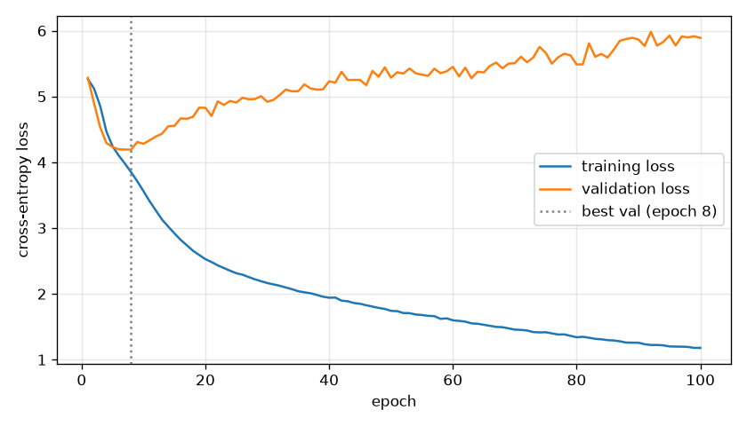
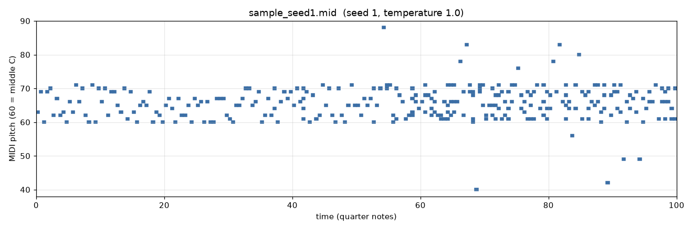
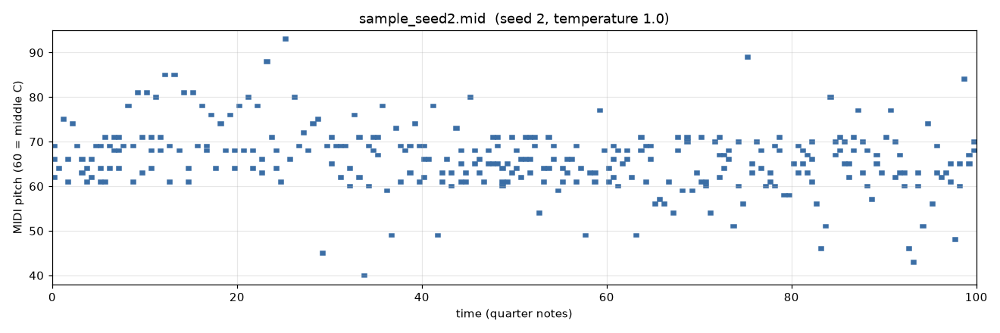
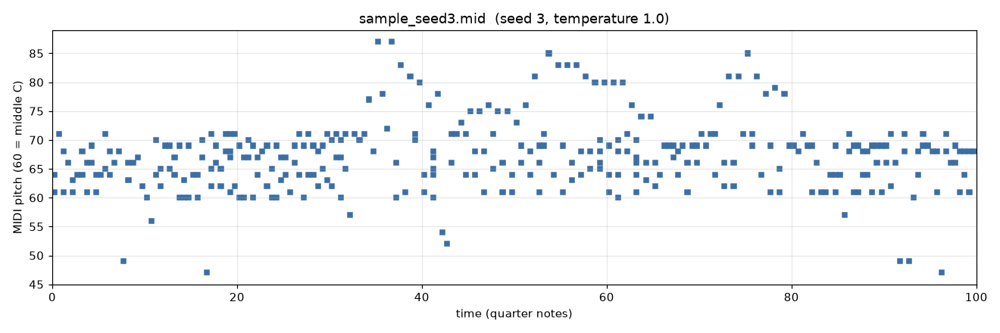

# NeuralSymphonizer

An LSTM that learns the next note or chord in classical piano MIDI files and then
generates new note sequences from it, written as MIDI. It is a learning project
built on the approach from Sigurður Skúli's 2017 tutorial (see [Credits](#credits)).

## What it does

- `MidiModelTraining.py` turns the 95 piano pieces in `midi_files/` into a stream of
  tokens per piece and trains a next-token model on them.
- `MidiGeneration.py` loads the trained model, gives it 50 tokens from a held-out
  piece as a starting prompt, samples new tokens one at a time and writes them to a
  MIDI file, with an optional piano-roll image.
- `render_audio.py` plays a MIDI file through a piano SoundFont and writes an MP3,
  and optionally a WAV and an MP4 with a moving playhead.

**Listen:** [seed 1](results/stage1-baseline/samples/sample_seed1.mp3) · [seed 2](results/stage1-baseline/samples/sample_seed2.mp3) ·
[seed 3](results/stage1-baseline/samples/sample_seed3.mp3) (MP3, 52 seconds each; see [Samples](#samples)).

## How it works

**Tokens.** `music21` parses each file. A single note becomes its pitch name
(`E5`, `B-4`). A chord becomes the pitch classes of its normal order joined by dots
(`4.7.11`), so chords keep which notes sound but not their octave. Rests, note
lengths, timing and dynamics are dropped. The corpus has 780 distinct tokens.
Tokens are cached in `data/notes.json`, which is rebuilt automatically if the set of
MIDI files changes (parsing all 95 files took about 2 minutes here).

**Split.** 10% of the pieces (10 of 95, chosen with a fixed seed and listed in
`results/stage1-baseline/model/config.json`) are held out for validation. Every window of 50 consecutive
tokens inside a piece is one example; the target is the 51st token. That gives
93,501 training and 9,610 validation windows.

**Model.** Embedding (64) → 3 stacked LSTM layers of 512 units, each followed by
dropout 0.2 → Dense 256 (ReLU) → dropout 0.2 → softmax over the 780 tokens;
5.76 million parameters, RMSprop, sparse categorical cross-entropy. The best
weights by validation loss are kept.

**Generation.** Each step feeds the last 50 tokens to the model, scales the
predicted distribution by a temperature (`--temperature 0` is greedy) and samples
the next token. Every generated token is written as a note or chord lasting an
eighth note (`--step 0.5` quarter notes), one after another; chord tokens are
placed in the octave above middle C.

## Setup

Tested on Windows 11 with Python 3.12.6 and an NVIDIA RTX 5070.

```bash
git clone https://github.com/OTewari/NeuralSymphonizer.git
cd NeuralSymphonizer
python -m venv .venv
```

Activate it (`.venv\Scripts\activate` on Windows, `source .venv/bin/activate`
elsewhere), then install PyTorch and the rest. With an NVIDIA GPU:

```bash
pip install torch --index-url https://download.pytorch.org/whl/cu128
pip install -r requirements.txt
```

CPU only:

```bash
pip install torch --index-url https://download.pytorch.org/whl/cpu
pip install -r requirements.txt
```

The scripts default `KERAS_BACKEND` to `torch`, so Keras uses PyTorch and
TensorFlow is not needed.

## Generate

The trained weights are in `results/stage1-baseline/model/` (`model.weights.h5`, 23 MB), so generation
works right after cloning:

```bash
python MidiGeneration.py --seed 1 --length 200 --temperature 1.0 --model-dir results/stage1-baseline/model --output results/stage1-baseline/samples/sample_seed1.mid --piano-roll
```

Options: `--length` (tokens to generate), `--seed`, `--temperature`, `--step`
(token duration in quarter notes), `--output`, `--piano-roll` (also writes a PNG
next to the MIDI file), `--model-dir`. The script prints statistics for the output
(see below). On the same machine the same seed gives the same file. On other
hardware it may not: run on the CPU, seed 2 produced a different sample from the
committed GPU one, because tiny numerical differences change which token is
sampled and everything after it follows from that.

## Render to audio

```bash
python render_audio.py results/stage1-baseline/samples/sample_seed1.mid results/stage1-baseline/samples/sample_seed2.mid results/stage1-baseline/samples/sample_seed3.mid --video
```

This writes `sample_seedN.mp3` next to each MIDI file and, with `--video`, an MP4
of the piano roll with a playhead (`.mp4` and `.wav` files are git-ignored). The
notes are synthesized offline with [TinySoundFont](https://pypi.org/project/tinysoundfont/)
and encoded with the ffmpeg binary that [imageio-ffmpeg](https://pypi.org/project/imageio-ffmpeg/)
installs, so no separate install is needed. By default it uses `TimGM6mb.sf2`, the
small General MIDI SoundFont that ships inside the `pretty_midi` package, with
preset 0 (Acoustic Grand Piano). It sounds basic. For a better piano, pass any
`.sf2` file with `--soundfont path/to/piano.sf2`. Other options: `--preset`,
`--bank`, `--wav`, `--bitrate`, `--tail`. Rendering the three samples took about
6 seconds.

## Train

The run whose results are shown below:

```bash
python MidiModelTraining.py --epochs 100 --units 512 --layers 3 --batch-size 64 --seed 42
```

Other options: `--seq-len`, `--embedding-dim`, `--dropout`, `--val-split`,
`--patience` (early stopping), `--max-files`, `--out-dir`. Training writes
`models/best.weights.h5` (checkpoint including optimizer state, git-ignored),
`models/model.weights.h5` (weights only, used by generation), `vocab.json`,
`config.json`, `history.csv` and `loss_curve.png`. The files from the run below were
then moved to `results/stage1-baseline/model/`, and its samples to
`results/stage1-baseline/samples/`, so that later stages can keep their own results
next to them.

## Test

```bash
python -m unittest discover -s tests -v
```

One smoke test trains a 16-unit, one-layer model for a few steps on the two
smallest MIDI files and generates 12 tokens. A second renders five tokens to MP3
and MP4. Together they took about 5 seconds on CPU here. The GitHub Actions
workflow in `.github/workflows/smoke-test.yml` runs them on CPU. On Linux,
`pip install -r requirements.txt` needs the PortAudio headers first
(`sudo apt-get install portaudio19-dev`), because `tinysoundfont` depends on
`pyaudio`, which has no Linux wheel. The rendering code never uses `pyaudio`.

## Results

### Training run

3 LSTM layers × 512 units, 100 epochs, batch size 64, seed 42, on an RTX 5070:
43.8 minutes. The console output is in [`results/stage1-baseline/model/train.log`](results/stage1-baseline/model/train.log) and
every epoch is in [`results/stage1-baseline/model/history.csv`](results/stage1-baseline/model/history.csv).



| | epoch | training loss | validation loss | validation accuracy |
|---|---|---|---|---|
| best by validation loss (the committed weights) | 8 | 3.848 | 4.192 | 12.7% |
| last epoch | 100 | 1.179 | 5.890 | 7.4% |

The model overfits after epoch 8: training loss keeps falling while validation
loss rises. For scale, on the same validation pieces a model that only knows how
often each token occurs in the training pieces scores 5.27, and uniform guessing
over the 780 tokens scores 6.66. So the kept model has learned something about
which token comes next, but it predicts the exact next token of an unseen piece
only about one time in eight.

### Samples

Three samples of 200 tokens each, temperature 1.0, seeds 1 to 3, made with the
command in [Generate](#generate). Each started from 50 tokens of a different
held-out piece. The statistics come from the script and from reading the written
MIDI file back with `music21`; the full output is in `results/stage1-baseline/samples/*.json`.

| sample | prompt taken from | distinct tokens | chord tokens | most common token (share) | longest run of one token | distinct pitches | pitch range | longest stretch copied from a training piece |
|---|---|---|---|---|---|---|---|---|
| [seed 1](results/stage1-baseline/samples/sample_seed1.mid) | `chpn_op35_4` | 68 | 185 | `0` (9%) | 3 | 21 | E2 to E6 | 5 tokens |
| [seed 2](results/stage1-baseline/samples/sample_seed2.mid) | `mz_311_1` | 94 | 119 | `8.11` (4%) | 2 | 38 | E2 to A6 | 3 tokens |
| [seed 3](results/stage1-baseline/samples/sample_seed3.mid) | `chpn_op53` | 78 | 144 | `4.8` (5%) | 2 | 31 | B2 to E♭6 | 3 tokens |





What this shows: the output is not stuck on one note, uses a wide range of the
vocabulary, and does not copy long passages from the training data. The prompt
affects the output strongly: the seed-1 prompt piece is almost entirely
single-pitch-class tokens (octave doublings), and 185 of the 200 generated tokens
in that sample are chord tokens too. The dense band between MIDI pitch 60 and 71
in every roll is the chord tokens, which are all placed in that octave.

What it does not show: whether the samples sound musical. With a 12.7% next-token
accuracy and no rhythm model, they should be expected to sound like a stream of
plausible-looking notes rather than a composition.

**Audio.** The MP3s ([seed 1](results/stage1-baseline/samples/sample_seed1.mp3), [seed 2](results/stage1-baseline/samples/sample_seed2.mp3),
[seed 3](results/stage1-baseline/samples/sample_seed3.mp3)) were made with the command in
[Render to audio](#render-to-audio) and checked without listening. Each decodes
to 52.0 seconds (50 s of notes and a 2 s release). No 250 ms stretch of the 50 s is
silent. The peak is 0.86 of full scale, so nothing clips. At all 339 onsets
where a single note starts on its own (140, 103 and 96 per file), the strongest
frequency 30–180 ms later is the note's fundamental or one of its first four
harmonics. So the audio contains the notes in the MIDI files, at the right
times.

## Limitations

- No rhythm: every generated token has the same length, and the model never sees
  note durations or rests. The output is a stream of evenly spaced notes and chords.
- Chords lose their octave and are all placed around middle C.
- Only the first instrument part of each file is read.
- The model overfits this small corpus quickly; see the loss curve.
- The statistics and audio checks show variety and correct rendering, not musical
  quality.
- The default SoundFont is a 6 MB General MIDI set, so the piano sounds basic.
- GitHub does not play audio files inside a README, so the MP3s are linked, not
  embedded.
- Validation uses only 10 pieces, so the validation loss is a rough number.

## Credits

- **Approach and original code structure:** Sigurður Skúli, *How to Generate Music
  using a LSTM Neural Network in Keras* (Towards Data Science, December 2017), and
  its repository [Skuldur/Classical-Piano-Composer](https://github.com/Skuldur/Classical-Piano-Composer)
  (MIT licence). The note/chord encoding, the stacked 512-unit LSTM design and
  the checkpoint naming in the first version of this repository follow it. Changes
  here: Keras 3 on PyTorch, an embedding layer instead of scaled integer inputs,
  a validation split by piece, windows that stay inside one piece, temperature
  sampling, piano-roll output and a smoke test.
- **Training data:** the MIDI files in `midi_files/` are by Bernd Krueger,
  [piano-midi.de](http://www.piano-midi.de). Every file carries a copyright meta
  event naming him (for example "Copyright © 2002 by Bernd Krueger"). His site
  licenses the files under the Creative Commons Attribution-ShareAlike licence
  (Germany): use and adaptation are allowed with attribution to Bernd Krueger and
  piano-midi.de, and redistribution must be under the same licence. The files in
  this repository are redistributed on those terms. The compositions are by Chopin,
  Beethoven and Mozart.
- Whether the generated samples count as adaptations of the training files is not
  settled here; they are shared on the same CC BY-SA terms to be safe.
- **Audio rendering:** the MP3s were synthesized with
  [TinySoundFont](https://pypi.org/project/tinysoundfont/) (Python bindings by
  Nathan Whitehead, MIT) using `TimGM6mb.sf2` (by Tim Brechbill, with additions by
  David Bolton; GPL-2 according to Debian's packaging), as bundled in
  [pretty_midi](https://github.com/craffel/pretty-midi), and encoded with the ffmpeg
  build from [imageio-ffmpeg](https://pypi.org/project/imageio-ffmpeg/). The
  SoundFont itself is not included in this repository.

## Licence

- **Code:** MIT, see [`LICENSE`](LICENSE). Parts of the code are adapted from
  Classical-Piano-Composer, which is also MIT-licensed; its copyright notice is
  reproduced in [`NOTICE.md`](NOTICE.md).
- **MIDI files and what is derived from them:** the MIT licence does not cover
  `midi_files/`. Those files keep the Creative Commons Attribution-ShareAlike
  terms described under [Credits](#credits). The token cache in `data/`, the
  trained weights and the generated files in `results/` are derived
  from them and are shared on the same terms to be safe.
